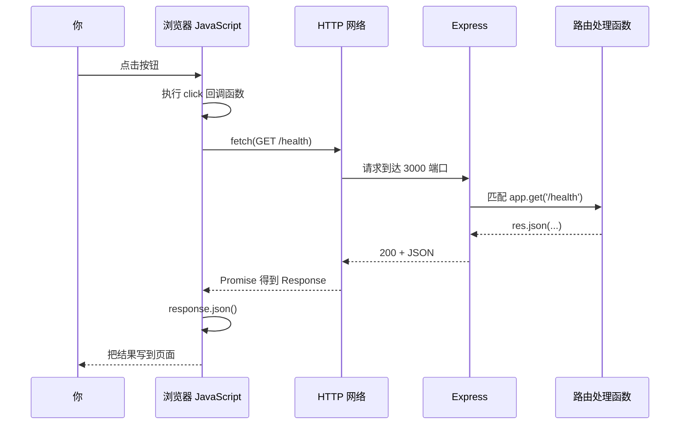

# 从 JavaScript 到 AJAX：看懂一次前后端调用

> 适合谁：能认出一点 JavaScript，但函数、Promise、HTTP、Express、JWT 还没有连成一条线的人。
>
> 学习目标：不靠死记，能够解释“点击按钮后，代码到底调用了谁”，并能自己写出一个符合本项目标准的 `fetch` 请求。

这不是原有 [系统学习指南](learning-guide.md) 的替代品。本文负责把第一遍讲慢、讲具体；学完后再用原指南复习完整架构。

## 0. 先把演示跑起来

在项目根目录打开 PowerShell：

```powershell
npm install
npm run learn:ajax
```

终端出现下面两类地址后，用浏览器打开教学网页：

```text
教学网页：http://127.0.0.1:5173
真实 API：http://127.0.0.1:3000
```

这个命令同时启动三样东西：

```text
浏览器教学页 :5173
        │ fetch / AJAX
        ▼
真实 Express API :3000
        │ Mongoose
        ▼
临时 MongoDB
```

按 `Ctrl+C` 后三者都会关闭，练习数据自动清空。它不读取你的 `.env`，也不需要 Docker、Atlas 或真实 JWT 密钥。

如果端口已占用，可以临时换端口：

```powershell
$env:LEARNING_API_PORT=3001
$env:LEARNING_WEB_PORT=5174
npm run learn:ajax
```

网页会自动使用新的 API 地址。环境变量只影响当前 PowerShell 窗口。

### 学习时只做四件事

每一关都按这个顺序：

1. **先猜**：这次会成功还是失败？为什么？
2. **再点**：按按钮发送真实请求。
3. **看四块面板**：`fetch`、请求包、后端调用链、响应包。
4. **自己复述**：谁调用了谁，数据在哪里变化？

不要一开始就背全部代码。你先要拥有一张完整地图。

---

## 1. 总地图：一次点击到底调用了谁

以网页上的“发送 `GET /health`”为例：



先记住一句话：

> **浏览器不会直接调用后端函数。浏览器发送 HTTP 请求；Express 根据“方法 + 路径”找到应该执行的 JavaScript 函数。**

这句话能区分两种“调用”：

- 同一个 JavaScript 程序内部：`createApp()` 是直接调用函数。
- 浏览器和后端之间：`fetch("http://.../health")` 是通过网络发请求，不是直接调用 `app.get`。

---

## 2. AJAX 之前，只补这些 JavaScript

### 2.1 变量：给一个值起名字

```js
const url = "http://127.0.0.1:3000/health";
let token = "";
```

- `const`：这个名字不再指向另一个值。
- `let`：以后可以重新赋值。
- `=`：把右边的值交给左边的名字，不是数学里的“相等证明”。

演示页把 Token 放在 `let` 管理的页面状态里。刷新页面后 JavaScript 重新执行，Token 就没了。

### 2.2 对象：把一组有名字的数据放在一起

```js
const user = {
  username: "学习者01",
  email: "learner@example.com",
  password: "password123",
};

console.log(user.email);
```

对象里的 `username`、`email`、`password` 叫属性。`user.email` 表示取出 `email` 属性。

对象不是 JSON。对象是 JavaScript 内存中的值；JSON 是跨网络传输时常用的文本格式：

```js
const jsonText = JSON.stringify(user); // 对象 → JSON 文本
const userAgain = JSON.parse(jsonText); // JSON 文本 → 对象
```

### 2.3 函数：一段可以被调用的步骤

```js
function add(a, b) {
  return a + b;
}

const result = add(2, 3);
```

逐句看：

- `function add(a, b)`：定义函数，`a`、`b` 是参数名字。
- `add(2, 3)`：现在才真正调用；`2`、`3` 是传入的实际值。
- `return`：把结果交回调用位置。
- `result` 最后得到 `5`。

只写 `add` 是“拿到这个函数”，写 `add()` 才是“立即调用这个函数”。

### 2.4 回调函数：先交给别人，满足条件后再调用

```js
button.addEventListener("click", function () {
  console.log("按钮被点击了");
});
```

浏览器先记住这个函数。用户还没点击时，它不会执行；发生 `click` 后，浏览器替你调用它。这种“以后再调用的函数”叫回调函数。

Express 路由也是同一个思想：

```js
app.get("/health", function (req, res) {
  res.json({ success: true, data: { status: "ok" } });
});
```

Express 先记住处理函数。只有收到 `GET /health` 时，Express 才调用它，并传入本次请求的 `req` 和本次响应的 `res`。

### 2.5 `req` 和 `res` 不是神秘关键字

它们只是常用参数名：

- `req` 是 request，保存客户端送来的路径、请求头、请求体等信息。
- `res` 是 response，提供 `status`、`json`、`send` 等方法，让后端构造响应。

换名字也能运行，但不建议这样写：

```js
app.get("/health", (incomingRequest, outgoingResponse) => {
  outgoingResponse.json({ success: true });
});
```

---

## 3. 第 1 关：第一次 `GET /health`

### 3.1 先预测

按演示页第 1 关按钮前回答：

1. `GET` 请求通常需要 JSON 请求体吗？
2. 成功状态码更可能是 `200` 还是 `404`？
3. 这一步需要 MongoDB 吗？

### 3.2 浏览器做了什么

核心代码只有两步：

```js
const response = await fetch("http://127.0.0.1:3000/health");
const result = await response.json();
```

第一行不是“立即得到 JSON”：

```text
调用 fetch
→ 浏览器开始发送请求
→ JavaScript 得到一个 Promise
→ await 暂停当前 async 函数
→ 服务器返回响应头和响应体
→ response 得到 Response 对象
```

第二行的 `response.json()` 继续读取响应体，并把 JSON 文本解析成 JavaScript 对象。

### 3.3 后端怎么接住它

教学启动器先完成：

```text
start-learning-demo.js
→ 启动临时 MongoDB
→ connectDatabase(...)
→ createApp()
→ app.listen(3000)
```

`src/app.js` 中已经注册了规则：

```js
app.get("/health", (req, res) => {
  res.json({ success: true, data: { status: "ok" } });
});
```

Express 匹配两个条件：

- 方法必须是 `GET`；
- 路径必须是 `/health`。

匹配成功后，它才调用右侧函数。这个接口只返回固定数据，所以不查询 MongoDB。

### 3.4 为什么需要 `app.listen`

下面四步不是同一件事：

```text
npm install express   下载 Express 代码
require("express")    把 Express 模块加载进当前文件
express()             创建一个 Express 应用对象
app.listen(3000)      让操作系统把 3000 端口交给这个进程
```

没有 `listen`，路由规则虽然存在，却没有网络入口。Supertest 测试可以直接把模拟请求交给 `createApp()`，所以测试时不必真的监听端口；浏览器 `fetch` 必须通过端口访问。

### 3.5 在 Network 面板亲眼确认

1. 按 `F12` 打开开发者工具。
2. 进入 `Network`，勾选 `Fetch/XHR`。
3. 再按一次“发送 `GET /health`”。
4. 点击出现的 `health` 请求。
5. 依次看 `Headers`、`Response`、`Timing`。

你应看到网页来自 `5173`，API 来自 `3000`。端口不同就是不同来源；`src/app.js` 中的 `cors()` 允许浏览器读取跨源响应。

### 3.6 费曼复述

合格答案不要求背代码，但要包含：

> 点击触发浏览器里的回调函数。回调函数用 `fetch` 向 3000 端口发送 `GET /health`。Express 根据方法和路径执行对应处理函数，`res.json` 返回 200 和 JSON。浏览器等待 Promise 完成，解析 JSON，再把内容写到页面。

---

## 4. HTTP 请求是一份前后端合同

一次请求至少要说清这些内容：

| 部分     | 例子                             | 回答的问题                   |
| -------- | -------------------------------- | ---------------------------- |
| Base URL | `http://127.0.0.1:3000`          | 请求发给哪台服务、哪个端口？ |
| Method   | `POST`                           | 想执行哪类动作？             |
| Path     | `/api/users/register`            | 操作哪个资源或功能？         |
| Headers  | `Content-Type: application/json` | 数据格式和身份是什么？       |
| Body     | `{ "username": "学习者01" }`     | 这次送了哪些数据？           |
| Status   | `201`                            | HTTP 层面的结果是什么？      |
| Response | `{ "success": true, ... }`       | 后端返回了什么业务数据？     |

### 常用方法

| 方法     | 本课程中的含义       | 通常有请求体 |
| -------- | -------------------- | ------------ |
| `GET`    | 查询                 | 否           |
| `POST`   | 创建用户、创建知识点 | 是           |
| `PATCH`  | 只修改给出的字段     | 是           |
| `DELETE` | 删除指定资源         | 否           |

### 常用状态码

| 状态码 | 本项目中的含义                 |
| ------ | ------------------------------ |
| `200`  | 查询、登录、更新或删除成功     |
| `201`  | 新资源创建成功                 |
| `400`  | 字段、类型或 ID 不合法         |
| `401`  | 没有有效身份                   |
| `404`  | 路由或当前用户可见的资源不存在 |
| `409`  | 用户名或邮箱重复               |
| `500`  | 后端出现未预期错误             |

`response.ok` 在状态码为 `200`～`299` 时是 `true`。要特别注意：

> `fetch` 收到 `400`、`401`、`404` 时通常不会自动进入 `catch`。服务器已经正常回信，只是明确告诉你请求失败，所以要检查 `response.ok`。

---

## 5. 第 2 关：注册为什么需要 `POST`、Header 和 Body

演示页发送的核心代码：

```js
const response = await fetch("http://127.0.0.1:3000/api/users/register", {
  method: "POST",
  headers: {
    "Content-Type": "application/json",
  },
  body: JSON.stringify({
    username: "学习者01",
    email: "learner@example.com",
    password: "password123",
  }),
});

const result = await response.json();
```

逐项解释：

- `method: "POST"`：告诉后端这是创建动作。
- `Content-Type`：告诉后端请求体是 JSON 文本。
- `JSON.stringify(...)`：把 JavaScript 对象转换成可以传输的 JSON 文本。
- `await response.json()`：把后端返回的 JSON 文本转换回对象。

### 注册请求在后端的真实路径

```text
src/app.js
  app.use(express.json())        把 JSON 文本解析成 req.body
  app.use('/api/users', ...)
        ↓
src/routes/userRoutes.js
  router.post('/register', register)
        ↓
src/controllers/userController.js
  register(req, res)
        ↓
src/validators/userValidator.js  检查用户名、邮箱、密码
        ↓
src/models/User.js               Mongoose 查询并创建用户
        ↓
MongoDB                          保存密码哈希，不保存明文密码
        ↓
src/utils/response.js            返回统一成功结构
```

完整路径由两段拼起来：

```text
app.use('/api/users', userRoutes)
+ router.post('/register', register)
= POST /api/users/register
```

### 故意发送错误字段

点击“故意发送错误字段”会送出：

```json
{ "username": "a", "email": "bad", "password": "123" }
```

验证器会返回 `400` 和稳定错误码：

```json
{
  "success": false,
  "error": {
    "code": "VALIDATION_ERROR",
    "message": "注册参数不符合要求",
    "details": ["username 长度必须为 2 到 50 个字符"]
  }
}
```

前端程序应主要判断 `400` 和 `VALIDATION_ERROR`。中文 `message` 是给人看的，以后可以修改或翻译。

### 自己复述

1. 为什么 `req.body` 不是浏览器中的原始对象？
2. `express.json()` 必须注册在路由之前的原因是什么？
3. 为什么注册成功是 `201` 而不是 `200`？

---

## 6. 第 3、4 关：登录、JWT 和认证中间件

### 6.1 HTTP 为什么“不记得刚才登录过”

每个 HTTP 请求原则上彼此独立：

```text
登录请求完成
≠
下一个请求自动知道你是谁
```

登录成功后，后端签发 JWT。客户端以后每次访问受保护接口，都把 Token 放进请求头：

```js
headers: {
  Authorization: `Bearer ${token}`,
}
```

这里的反引号字符串允许 `${token}` 把变量值放进文本。

### 6.2 Token 在本演示中怎样保存

```js
let token = "";

// 登录成功后
token = result.data.token;
```

它只存在当前页面内存中：

- 刷新页面后消失，需要重新登录；
- 页面只显示头尾几位，避免把完整 Token 暴露在演示界面；
- 开发者工具仍能看到本地练习请求，不要在演示中使用真实生产账号或 Token。

这不等于所有生产项目都必须这样保存。浏览器 Token 存储方案要结合 XSS、CSRF、刷新 Token 和部署架构单独设计；本课程只建立 Bearer Token 调用链。

### 6.3 认证中间件像流水线保安

知识点路由先执行：

```js
router.use(auth);
```

然后才可能进入 CRUD 控制器：

```text
请求进入
→ auth 读取 Authorization
→ jwt.verify 检查签名和过期时间
→ 把 user.id 放入 req.user
→ next() 放行
→ 知识点控制器
```

没有 Token：

```json
{
  "success": false,
  "error": {
    "code": "AUTH_REQUIRED",
    "message": "需要登录后才能访问此接口"
  }
}
```

伪造 Token：

```json
{
  "success": false,
  "error": {
    "code": "INVALID_TOKEN",
    "message": "Token 无效"
  }
}
```

两者都是 `401`，但机器错误码不同，前端可以采取不同提示或恢复动作。

### 自己复述

1. 为什么登录成功后，每个知识点请求仍要带 Token？
2. `next()` 是返回响应，还是把控制权交给下一站？
3. JWT Payload 能不能放密码？为什么？

---

## 7. 第 5、6 关：知识点 CRUD 完整闭环

### 7.1 五个正式接口

| 动作   | 方法与路径                         | 请求体                |
| ------ | ---------------------------------- | --------------------- |
| 创建   | `POST /api/knowledge-points`       | `title`、`content` 等 |
| 查列表 | `GET /api/knowledge-points`        | 无                    |
| 查详情 | `GET /api/knowledge-points/:id`    | 无                    |
| 更新   | `PATCH /api/knowledge-points/:id`  | 只传要改的字段        |
| 删除   | `DELETE /api/knowledge-points/:id` | 无                    |

`:id` 是路由参数。例如：

```text
/api/knowledge-points/66ab1234...
                      └── req.params.id
```

### 7.2 创建

```js
const response = await fetch(`${apiBaseUrl}/api/knowledge-points`, {
  method: "POST",
  headers: {
    "Content-Type": "application/json",
    Authorization: `Bearer ${token}`,
  },
  body: JSON.stringify({
    title: "我理解 AJAX 了",
    content: "浏览器通过 fetch 调用后端。",
    status: "not_started",
    reviewList: false,
  }),
});
```

注意：`false` 是布尔值，`"false"` 是字符串，两者不同。

### 7.3 查询列表

```js
const response = await fetch(`${apiBaseUrl}/api/knowledge-points`, {
  headers: { Authorization: `Bearer ${token}` },
});
```

GET 不需要写 `method`，因为 `fetch` 默认就是 GET；它也不需要请求体。

### 7.4 更新

```js
await fetch(`${apiBaseUrl}/api/knowledge-points/${id}`, {
  method: "PATCH",
  headers: {
    "Content-Type": "application/json",
    Authorization: `Bearer ${token}`,
  },
  body: JSON.stringify({ status: "mastered", reviewList: true }),
});
```

本项目正式使用 PATCH 表示部分更新。只允许更新 `title`、`content`、`status`、`reviewList`，不能把 `user` 等内部字段直接写入。

### 7.5 删除

```js
await fetch(`${apiBaseUrl}/api/knowledge-points/${id}`, {
  method: "DELETE",
  headers: { Authorization: `Bearer ${token}` },
});
```

删除成功后，后端返回被删除的 ID；演示页再清空“当前 ID”。这是两处不同的状态变化：数据库删除资源，浏览器更新页面状态。

### 7.6 数据库为什么需要 `await`

```js
const knowledgePoint = await KnowledgePoint.create({ ...input });
```

调用 `KnowledgePoint.create()` 时，JavaScript 不能立刻得到数据库结果：

```text
提交数据库操作
→ 立即得到 Promise
→ MongoDB 在之后完成写入
→ Promise 完成
→ await 得到保存后的文档
→ 后端才能构造准确响应
```

### 7.7 为什么别人看不到你的知识点

后端不是只按知识点 ID 查询，而是同时检查当前 Token 中的用户 ID：

```js
KnowledgePoint.findOne({
  _id: id,
  user: req.user.id,
});
```

这属于授权。认证回答“你是谁”，授权回答“你能操作什么”。

---

## 8. Promise、`async/await` 和错误处理

### 8.1 Promise 是“未来结果的收据”

同步函数通常立刻返回结果：

```js
const total = 1 + 2;
```

网络请求不可能立刻完成。`fetch` 先返回 Promise：

```js
const promise = fetch(url);
```

Promise 最后只有三种状态：

- `pending`：还在等；
- `fulfilled`：完成并得到结果；
- `rejected`：操作本身失败。

### 8.2 `await` 只能在 `async` 函数中使用

```js
async function loadHealth() {
  const response = await fetch(`${apiBaseUrl}/health`);
  const result = await response.json();
  return result;
}
```

时间顺序一定是：

```text
调用 loadHealth()
→ loadHealth 立即返回 Promise
→ fetch 发出请求
→ await 暂停 loadHealth，不是卡死整个浏览器
→ 其他点击、绘制仍可继续
→ 响应回来
→ loadHealth 从暂停处继续
```

### 8.3 HTTP 错误和网络错误必须分开

```js
try {
  const response = await fetch(url, options);
  const result = await response.json();

  if (!response.ok) {
    console.log("后端已回信，但业务请求失败", response.status, result);
    return;
  }

  console.log("成功", result.data);
} catch (error) {
  console.log("没有收到可用的 HTTP 响应", error);
}
```

四层错误不要混在一起：

| 层次           | 例子                  | 是否到达后端       |
| -------------- | --------------------- | ------------------ |
| 浏览器本地状态 | 没有 ID，前端阻止发送 | 否                 |
| 网络错误       | 后端没启动、端口错误  | 否或未完成         |
| HTTP/API 错误  | 400、401、404、409    | 是，后端明确返回   |
| 未预期后端错误 | 500                   | 是，但后端内部失败 |

演示页把网络错误显示成 `CLIENT_NETWORK_ERROR`。这是教学前端自己的错误码，不是服务器返回的 API 合同。

---

## 9. 可以复用的 `fetch` 标准函数

当你理解前面步骤后，可以把重复工作封装起来：

```js
async function apiFetch(path, { method = "GET", body, token } = {}) {
  let response;

  try {
    response = await fetch(`http://127.0.0.1:3000${path}`, {
      method,
      headers: {
        ...(body ? { "Content-Type": "application/json" } : {}),
        ...(token ? { Authorization: `Bearer ${token}` } : {}),
      },
      ...(body ? { body: JSON.stringify(body) } : {}),
    });
  } catch (cause) {
    throw {
      kind: "network",
      code: "CLIENT_NETWORK_ERROR",
      message: "无法连接服务器",
      cause,
    };
  }

  const result = await response.json();
  if (!response.ok || result.success === false) {
    throw {
      kind: "api",
      status: response.status,
      code: result.error?.code || "UNKNOWN_API_ERROR",
      message: result.error?.message || "请求失败",
      details: result.error?.details,
    };
  }

  return result.data;
}
```

调用创建接口：

```js
try {
  const data = await apiFetch("/api/knowledge-points", {
    method: "POST",
    token,
    body: {
      title: "AJAX 调用链",
      content: "从点击一直追踪到 MongoDB。",
    },
  });

  console.log(data.knowledgePoint);
} catch (error) {
  if (error.kind === "network") {
    showMessage("服务暂时无法连接");
  } else if (error.status === 401) {
    showMessage("登录已失效，请重新登录");
  } else {
    showMessage(error.message);
  }
}
```

这个封装的价值不是“代码看起来高级”，而是让所有调用遵守同一套规则：

- 有 body 才添加 JSON Header 和 `JSON.stringify`；
- 有 Token 才添加 Bearer Header；
- HTTP 失败和网络失败分开；
- 成功只把 `data` 交给页面；
- 程序判断稳定的状态码与 `error.code`。

---

## 10. 前后端 AJAX 协作标准卡

以后新增接口，不要只说“给我一个新增功能”。前后端至少共同确认下面这张卡。

### 10.1 空白模板

```md
## 接口名称

- 目的：
- Method + Path：
- 是否认证：否 / Bearer Token
- Path 参数：
- Query 参数：
- Request Body：字段、类型、必填、约束
- 成功状态码：
- 成功响应 data：
- 失败状态码与 error.code：
- 数据归属/权限：
- 前端成功后更新什么页面状态：
- 前端失败后如何提示或恢复：
- 验证证据：OpenAPI / 自动测试 / 浏览器 Network
```

### 10.2 本项目的完整示例

```md
## 创建知识点

- 目的：给当前登录用户创建一条知识点
- Method + Path：POST /api/knowledge-points
- 是否认证：Authorization: Bearer <token>
- Request Body：
  - title: string，必填，1～120 字符
  - content: string，必填，1～20000 字符
  - status: not_started | in_progress | mastered，可选
  - reviewList: boolean，可选
- 成功状态码：201
- 成功响应：data.knowledgePoint
- 常见失败：
  - 400 VALIDATION_ERROR
  - 401 AUTH_REQUIRED / INVALID_TOKEN / TOKEN_EXPIRED
- 权限：服务端强制使用 Token 中的 user.id，前端不能指定 user
- 页面状态：把新 ID 保存为当前 ID，列表数量 +1
- 验证：docs/openapi.yaml + tests/knowledgePoints.test.js + Network 面板
```

### 10.3 前端不要猜这些事情

在协作开始前必须明确：

- 路径到底是 `/api/users/register` 还是别的；
- 是 GET、POST、PATCH 还是 DELETE；
- Token 放 Header、Cookie 还是别处；
- 字段叫 `username` 还是 `name`；
- 成功数据位于 `data` 的哪一层；
- 每种失败的状态码和稳定错误码；
- 更新成功后前端是局部更新、重新查询还是跳转页面。

本项目机器可读的正式合同是 [OpenAPI](openapi.yaml)。教学文档帮助你理解，OpenAPI 和自动测试负责防止双方记错。

---

## 11. 调试顺序：请求失败先看哪里

按固定顺序排查，不要一失败就改代码。

1. 看教学启动终端是否仍在运行。
2. 在浏览器直接访问 `http://127.0.0.1:3000/health`。
3. 打开 Network，确认请求是否出现。
4. 看 Request URL 和 Method 是否正确。
5. 有请求体时，看 `Content-Type` 和 Payload。
6. 受保护接口看 `Authorization` 是否为 Bearer 格式。
7. 看 HTTP Status。
8. 看响应中的 `error.code` 和 `details`。
9. 最后再沿调用链定位后端文件。

### 常见现象

| 现象                      | 最可能原因                      | 下一步                             |
| ------------------------- | ------------------------------- | ---------------------------------- |
| `Failed to fetch`         | 后端未启动、端口错误、网络/CORS | 先访问 `/health`，看终端和 Network |
| `404 ROUTE_NOT_FOUND`     | 方法或路径没有匹配              | 对照 OpenAPI 的 Method + Path      |
| `400 VALIDATION_ERROR`    | 字段类型、长度或值错误          | 看 `error.details`                 |
| `401 AUTH_REQUIRED`       | 没发送 Token                    | 检查 Authorization Header          |
| `401 INVALID_TOKEN`       | Token 被修改或不是本服务签发    | 重新登录获取 Token                 |
| `409 USER_ALREADY_EXISTS` | 用户名或邮箱重复                | 更换值或直接登录                   |
| 页面说没有 ID             | 还没有创建/选择知识点           | 先创建或查询列表；请求尚未发出     |

---

## 12. `fetch` 与 axios 只做对照

AJAX 是目标，`fetch` 和 axios 是实现手段。本课程先用浏览器原生 `fetch`，避免同时学习两套规则。

同一个 GET：

```js
// fetch
const response = await fetch(url, {
  headers: { Authorization: `Bearer ${token}` },
});
const result = await response.json();
```

```js
// axios
const response = await axios.get(url, {
  headers: { Authorization: `Bearer ${token}` },
});
const result = response.data;
```

关键差异：

- `fetch` 是浏览器原生能力；axios 需要额外安装或引入。
- `fetch` 要显式调用 `response.json()`；axios 通常已解析 JSON。
- `fetch` 收到 400/500 默认仍会正常完成 Promise；axios 默认把非 2xx 当作 rejected Promise。
- 无论使用哪个工具，Method、Path、Header、Body、状态码和响应结构都不能改变。

掌握合同后，换工具只是语法变化。

---

## 13. 分阶段验收

### 第一阶段：能读懂

- [ ] 能区分函数定义和函数调用。
- [ ] 能解释回调为什么不是立刻执行。
- [ ] 能区分 JavaScript 对象和 JSON 文本。
- [ ] 能说出 `req` 和 `res` 分别属于哪一侧。

### 第二阶段：能追踪

- [ ] 能从点击一路追到 `app.get("/health")`。
- [ ] 能解释完整路径如何由 app 前缀和 router 路径拼接。
- [ ] 能区分浏览器状态、HTTP 响应和数据库状态。
- [ ] 能解释 `await` 在等什么。

### 第三阶段：能独立调用

- [ ] 能写出带 JSON Body 的 POST。
- [ ] 能写出带 Bearer Token 的 GET。
- [ ] 能用 `response.ok` 区分 2xx 与 API 错误。
- [ ] 能用 `try/catch` 处理没有 HTTP 响应的网络错误。
- [ ] 能依据 `status + error.code` 决定前端行为。

### 最终费曼题

不看本文，回答：

> 用户点击“创建知识点”后，从按钮事件到 MongoDB 保存，再到页面显示成功，依次经过哪些对象、函数和文件？如果 Token 缺失，流程在哪一站停止？如果后端没有启动，为什么不会得到 500？

---

## 14. 参考答案

### 第 3 章

1. GET 查询通常没有请求体。
2. 已注册的 `/health` 成功返回 200；错误路径才是 404。
3. 当前实现返回固定健康状态，不查询 MongoDB；但教学启动器仍先启动数据库，供后续关卡使用。

### 第 5 章

1. 浏览器对象先被 `JSON.stringify` 转成文本；网络传输文本；`express.json()` 再解析成后端 `req.body` 对象。
2. Express 按注册顺序执行中间件；路由先执行就读不到解析后的 `req.body`。
3. 201 明确表示成功创建了新资源。

### 第 6 章

1. HTTP 无状态，下一次请求不会自动继承上一次登录身份。
2. `next()` 把控制权交给 Express 流水线下一站，不是发送响应。
3. JWT Payload 只是编码，不是加密；拿到 Token 的人可以查看内容，所以不能放密码。

### 最终费曼题参考主线

```text
按钮 click 回调
→ fetch 构造 POST + JSON + Bearer Token
→ 浏览器通过 HTTP 发到 3000 端口
→ app.js 的 CORS 与 express.json
→ auth 中间件验证 JWT，写入 req.user
→ knowledgePointRoutes 匹配 POST /
→ createKnowledgePoint 控制器
→ validator 校验输入
→ KnowledgePoint Model 调用 MongoDB
→ sendSuccess 返回 201 + JSON
→ 浏览器 await 得到 Response
→ response.json 解析
→ 页面保存 ID 并更新显示
```

缺少 Token 时，流程在 `auth` 中间件停止并返回 401。后端没有启动时，请求根本没有进入 Express，因此没有服务器可以返回 500；浏览器得到的是网络连接错误。

完成本文后，再阅读 [系统学习指南](learning-guide.md)、[知识点速查](quick-reference.md) 和 [苏格拉底式自测](self-test.md)，你会发现原来压缩在一起的术语已经能逐项对上真实操作。
