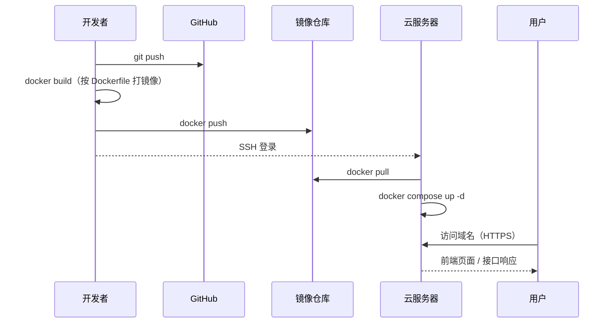
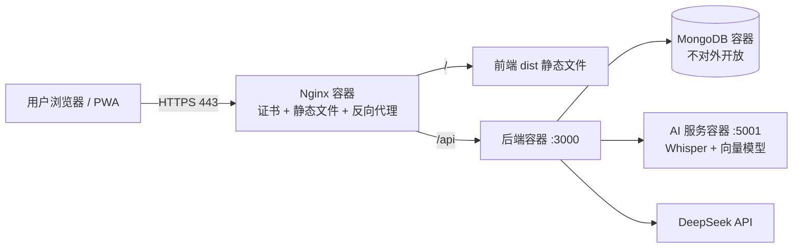

# 部署说明（第 16 课，理论）

老师说明第 16 课部署只讲理论、不实际上云，所以本项目**没有部署到云服务器**。这份文档讲两件事：仓库里已经有的容器化配置（本机能跑），以及真要上线还差什么、怎么做。

## 为什么要部署、为什么用容器

现在的应用只能在自己电脑上用（`localhost`）。部署就是把它放到一台 24 小时在线、有公网地址的服务器上。用 Docker 部署的好处：

- **环境一致**：Node 版本、依赖、启动命令都写进镜像，在我电脑上能跑，在服务器上就一样能跑。
- **部署简单**：服务器上只装 Docker，不用逐个装 Node、MongoDB。
- **隔离**：每个服务一个容器，互不影响，换服务器时整体搬走。

典型流程：

## 仓库里已有的：后端 + 数据库（本机可运行）

根目录的 `Dockerfile` 和 `compose.yaml` 从第 3 课起就有，本机执行 `docker compose up --build -d` 后用 `scripts/smoke-test.ps1` 冒烟测试（见 README「方式二」）。

和讲义示例 Dockerfile 的区别：

| 讲义             | 本项目                               | 好处                                                     |
| ---------------- | ------------------------------------ | -------------------------------------------------------- |
| `node:18-alpine` | `node:22-alpine`                     | Node 18 已停止维护                                       |
| `npm install`    | `npm ci --omit=dev`                  | 严格按锁文件安装，不装测试工具，镜像更小                 |
| `COPY . .`       | 只复制 `src/` 和 `docs/openapi.yaml` | 测试、文档、`.env` 不进镜像（另有 `.dockerignore` 兜底） |
| 以 root 运行     | `USER node`                          | 容器被攻破时权限更小                                     |

`compose.yaml` 编排两个服务：

- `mongo`：MongoDB 8.0，数据存在命名卷 `feynman-mongo-data`，容器删了数据还在；带健康检查。
- `app`：后端，等 `mongo` 健康后才启动；`restart: unless-stopped` 负责崩溃后自动重启——这就是讲义说的「Docker 的重启策略可以替代 PM2」。

注意：`compose.yaml` 里的 `JWT_SECRET` 是课程演示用的固定值，只能在本机用；上线必须换成随机长密钥，并且通过服务器上的环境变量或密钥文件传入，不写进仓库。

## 上线还差什么（没做，写给以后）

完整上线后的结构：

| 要补的      | 做法                                                                                                         | 注意                                                                                             |
| ----------- | ------------------------------------------------------------------------------------------------------------ | ------------------------------------------------------------------------------------------------ |
| 前端容器    | 讲义的多阶段构建：第一阶段 `npm ci && npm run build`，第二阶段把 `dist/` 复制进 `nginx:stable-alpine`        | 构建时设 `VITE_API_BASE_URL=/api`，前端请求同域的 `/api`，不再写死 `localhost:3000`              |
| Nginx 配置  | 单页应用兜底：`try_files $uri /index.html;`（否则刷新 `/graph` 是 404）；`location /api/` 反向代理到后端     | 知识库问答的流式接口要关缓冲：`proxy_buffering off;`，否则回答会攒到最后一次性出来               |
| HTTPS       | 买域名，用 Let's Encrypt 免费证书（certbot，或改用自带证书的 Caddy）                                         | PWA 必须 HTTPS 才能在手机上安装；JWT 走明文 http 会被截获                                        |
| AI 服务容器 | `whisper-service` 做成 Python 镜像，模型文件（Whisper small 约 460MB、向量模型约 390MB）用卷挂载，不打进镜像 | 云服务器多数没有显卡，Whisper 在 CPU 上转写会慢；本地 Ollama 需要显卡，上线后大模型只用 DeepSeek |
| 密钥        | `JWT_SECRET`、`DEEPSEEK_API_KEY` 放服务器环境变量或 Docker secrets                                           | 不进仓库、不进镜像                                                                               |
| 安全收紧    | 后端 `cors()` 改成只允许自己的域名；MongoDB 端口不映射到公网；加登录接口限流                                 | 现在全放开是为了本机和 Electron（来源是 `null`）方便                                             |
| 运维        | 定期备份 MongoDB 卷（`mongodump`）；看容器日志；更新时 `docker compose pull && up -d`                        | 建索引的队列只在一个后端进程里有效，扩成多实例前要换成数据库锁或任务队列                         |

PM2 和 Nginx 的角色：用 Docker 后，进程守护交给 Docker 的重启策略，不再需要 PM2；Nginx 仍然有用，作为唯一对外入口，统一处理 HTTPS 证书、静态文件和 `/api` 转发。不用 Docker 直接部署时，才用 PM2 守护 Node 进程。

## 费用和取舍

云服务器、域名、证书申请都涉及花钱或实名，按约定不由 AI 操作；课程要求也只到理论。真要上线，最小配置是一台 2 核 4G 的云服务器（跑后端、MongoDB 和 Nginx），AI 服务和大模型用 API 或另配 GPU 机器。
