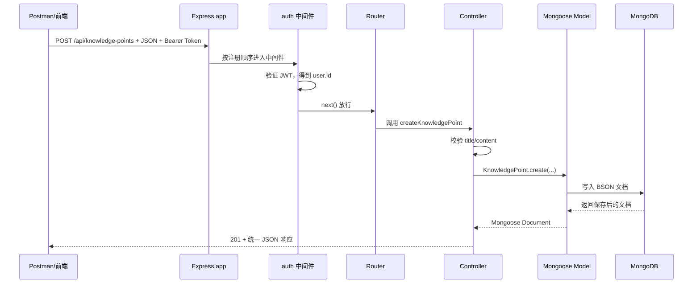

# 系统学习指南：从一次 HTTP 请求看懂前三课

这份指南写给“跟着 AI 做过项目，但还不能独立解释代码”的学习者。不要先背每个 API；先抓住一条主线：**客户端发出请求，服务器理解请求，执行业务规则，读写数据库，再返回响应。**

建议学习顺序：先通读第 1～4 章，再打开源码逐段对照；每学完一课，完成对应验收清单和自测题。

## 1. 先建立完整地图

一次“创建知识点”请求会经历下面的路径：



把项目目录映射到这条链路：

- `src/app.js`：组装整条请求流水线。
- `src/routes/`：决定某个“方法 + 路径”由谁处理。
- `src/middleware/`：在业务处理前做通用工作，例如认证。
- `src/controllers/`：描述注册、登录、CRUD 的业务步骤。
- `src/validators/`：把“不合法输入”挡在数据库之前。
- `src/models/`：定义数据形状，并通过 Mongoose 操作 MongoDB。
- `src/config/`：集中处理数据库、JWT、Swagger 等配置。
- `src/server.js`：连接数据库、监听端口、优雅关闭。

## 2. 第一课：Node.js、npm 与 Express

### 2.1 “大前端”和全栈是什么

传统前端主要运行在浏览器中；“大前端”强调 JavaScript/TypeScript 能覆盖 Web、移动端、桌面端、可视化和服务端协作。全栈不是要求一个人精通所有平台，而是能理解从界面到 API、数据库和部署的完整链路。

前三课只实现这张地图里的**后端基础**。讲义对 React、桌面端、录音、AI 和知识图谱的描述是未来蓝图，不是当前已实现功能。

### 2.2 Node.js 到底做了什么

JavaScript 原本主要在浏览器的 JavaScript 引擎中运行。Node.js 提供了另一个运行环境，让 JavaScript 可以读文件、监听网络端口、连接数据库并作为服务器长期运行。

```powershell
node -v
npm -v
```

- `node` 负责执行 JavaScript。
- `npm` 负责下载依赖、记录版本并执行 `package.json` 中的脚本。
- `node_modules` 是下载后的依赖目录，可以用 `npm install` 重建，因此不提交 Git。
- `package-lock.json` 锁定依赖树，保证不同电脑安装出尽量一致的结果，应提交 Git。

### 2.3 CommonJS 模块

本项目沿用讲义的 CommonJS：

```js
const express = require("express");
module.exports = { createApp };
```

`require` 是导入，`module.exports` 是导出。只有导出的内容才能被其他文件使用。现代项目也常用 ESM 的 `import/export`，但不要在没有配置的情况下混用两套语法。

### 2.4 Express 的最小模型

```js
app.get("/", (req, res) => {
  res.send("Hello, Feynman Learner!");
});
```

- `app.get` 注册一个只响应 GET 请求的路由。
- `/` 是路径。
- `req` 是客户端送来的请求。
- `res` 是服务器将要发回的响应。
- `res.send` 可以返回文本；`res.json` 返回 JSON 并设置正确的响应头。

运行 `node src/server.js` 后，`app.listen(3000)` 才真正占用端口并等待请求。项目把 `createApp()` 与 `listen()` 分开，是因为自动测试只需要创建应用，不应该真的占用 3000 端口。

### 2.5 环境变量

`process.env.PORT`、`process.env.STUDENT_NAME` 都来自进程环境。`.env` 是本地保存环境变量的一种方便方式，`dotenv` 会把它加载到 `process.env`。

环境变量适合存放：

- 不同环境会变化的端口、数据库地址。
- JWT 密钥等不能写死在源码里的秘密。

`.env.example` 只提供字段和安全占位值；真正的 `.env` 已被 `.gitignore` 排除。

### 2.6 Git 是快照系统

三个最重要的动作：

```powershell
git add .
git commit -m "清楚描述这次完成了什么"
git log --oneline --decorate
```

- 工作区：你正在修改的文件。
- 暂存区：下一次提交准备包含的内容。
- 提交：一个有父子关系、可定位的项目快照。

本项目的 `lesson-1`、`lesson-2`、`lesson-3` 标签分别指向三次课完成时的真实提交。标签像书签，提交才是内容本身。

## 3. 第二课：API、MongoDB 与用户注册

### 3.1 API 是前后端合同

一个 API 合同至少包含：

1. 请求方法与路径，例如 `POST /api/users/register`。
2. 请求头，例如 `Content-Type: application/json`。
3. 请求体字段及约束。
4. 成功和失败的状态码。
5. 响应 JSON 的形状。

REST 把业务对象看成资源，并主要用 HTTP 方法表示动作：

| 方法   | 常见含义                   | 是否通常带请求体 |
| ------ | -------------------------- | ---------------- |
| GET    | 查询                       | 否               |
| POST   | 创建或触发动作             | 是               |
| PUT    | 完整替换；本课程兼容为更新 | 是               |
| PATCH  | 部分更新                   | 是               |
| DELETE | 删除                       | 否               |

状态码不是装饰：`201` 表示创建成功，`400` 表示输入不合法，`401` 表示没有有效身份，`404` 表示资源不可见，`409` 表示唯一值冲突，`500` 才是服务器未预期错误。

### 3.2 JSON、BSON、MongoDB

客户端传来的 JSON 是文本格式；MongoDB 内部存 BSON，可以保存更多数据类型。MongoDB 中常用的层次是：

```text
数据库 feynman-db
├── users 集合
│   └── 用户文档
└── knowledgepoints 集合
    └── 知识点文档
```

MongoDB 是文档数据库，不代表“完全没有结构”。应用仍需要约束哪些字段必填、类型是什么、是否唯一。

### 3.3 Mongoose 与 Schema

Mongoose 是 Node.js 和 MongoDB 之间的 ODM：把 JavaScript 对象、Schema 和数据库文档连接起来。

`src/models/User.js` 定义：

- `username`、`email`、`password` 都必填。
- 用户名和邮箱具有唯一索引。
- 邮箱保存前转小写。
- `password` 默认不参与查询结果，避免意外泄露。
- `timestamps` 自动生成 `createdAt` 和 `updatedAt`。

`unique: true` 主要创建唯一索引，不等于完整的输入验证，所以控制器仍主动检查重复，错误处理中间件也兜底处理数据库的 `11000` 冲突。

### 3.4 Promise、async 与 await

数据库和密码哈希不是立即完成的操作，会返回 Promise。把流程展开看：

```text
调用 User.findOne()
→ 立即得到 Promise
→ 数据库在之后完成查询
→ await 等待 Promise 得到结果
→ 才能继续判断用户是否存在
```

`async function` 总会返回 Promise；函数内部可以用 `await`。如果 Promise 失败，就会抛出错误。Express 5 能把异步路由抛出的错误交给最后的错误处理中间件。

### 3.5 为什么密码不能“加密后再解密”

服务器不需要知道用户原密码，只需要判断本次输入是否匹配。因此使用单向哈希：

```text
注册：原密码 + 随机盐 → bcrypt 哈希 → 保存哈希
登录：本次原密码 + 已保存哈希 → bcrypt.compare → true/false
```

盐让相同密码得到不同哈希，降低彩虹表攻击价值。`bcrypt.hash(password, 10)` 中的 10 是成本因子；越大计算越慢。API 响应永远不返回密码字段，日志也不应记录原密码。

### 3.6 中间件顺序为什么重要

`app.use(express.json())` 必须在读取 `req.body` 的路由之前注册，否则 Express 不知道如何把 JSON 文本解析成对象。错误处理中间件必须在所有路由之后，才能接住前面传来的错误。

CORS 是浏览器的跨源安全规则。前端在 `localhost:5173`、后端在 `localhost:3000` 时，来源不同；`cors()` 给响应添加允许跨源访问的头。Postman 和服务器端脚本不受浏览器 CORS 限制。

## 4. 第三课：JWT、认证与知识点 CRUD

### 4.1 HTTP 无状态意味着什么

每个 HTTP 请求原则上独立。登录成功后，下一次请求不会自动携带“刚才是哪个用户”的内存。JWT 让客户端每次带上一张服务器签名的短期凭证。

JWT 由三段组成：Header、Payload、Signature。Payload 只是 Base64URL 编码，不是加密，任何拿到 Token 的人都能查看，所以不要放密码和敏感信息。本项目只放 `user.id`。

签名证明 Token 没被篡改；它不阻止别人窃取后使用 Token。因此真实系统必须使用 HTTPS、妥善保存 Token，并设置合理过期时间。

### 4.2 认证与授权不是一回事

- 认证 Authentication：你是谁？本项目通过验证 JWT 得到 `req.user.id`。
- 授权 Authorization：你能操作什么？查询知识点时必须同时匹配知识点 ID 和当前用户 ID。

只验证 Token、不检查资源所属用户，会产生越权漏洞。项目查询单条知识点时使用 `{ _id: id, user: req.user.id }`；其他用户访问时返回 404，避免泄露该 ID 是否真实存在。

### 4.3 认证中间件的实际步骤

`src/middleware/auth.js` 按顺序完成：

1. 首选读取 `Authorization: Bearer <token>`。
2. 兼容读取讲义中的 `x-auth-token`。
3. 两个头同时存在但内容不同则拒绝。
4. 用 `JWT_SECRET` 验证签名和过期时间。
5. 把载荷中的用户 ID 放入 `req.user`。
6. 调用 `next()` 进入知识点路由。

`next()` 不是“结束”，而是把控制权交给流水线中的下一站。若中间件已经发送响应，就不应再调用 `next()`。

### 4.4 CRUD 如何对应代码

| 动作      | API                                | 控制器行为                  |
| --------- | ---------------------------------- | --------------------------- |
| Create    | `POST /api/knowledge-points`       | 校验并写入当前用户 ID       |
| Read list | `GET /api/knowledge-points`        | 只查询当前用户并倒序排列    |
| Read one  | `GET /api/knowledge-points/:id`    | 校验 ID，再按 ID + 用户查询 |
| Update    | `PATCH` 或兼容 `PUT`               | 只允许四个白名单字段        |
| Delete    | `DELETE /api/knowledge-points/:id` | 先验证归属再删除            |

`status` 是有限状态集合：`not_started`、`in_progress`、`mastered`。枚举能阻止拼写错误变成永久脏数据。`reviewList` 必须是真正的布尔值，字符串 `"false"` 不是布尔值。

### 4.5 路由参数和 ObjectId

路径 `/api/knowledge-points/:id` 中的 `:id` 会成为 `req.params.id`。MongoDB ObjectId 的文本形式是 24 位十六进制字符。先验证格式，可以把客户端输入错误稳定地返回为 400，而不是让它变成数据库或服务器错误。

### 4.6 统一响应和错误

成功响应：

```json
{
  "success": true,
  "data": {},
  "message": "可选的人类可读说明"
}
```

失败响应：

```json
{
  "success": false,
  "error": {
    "code": "稳定的机器错误码",
    "message": "给人看的说明",
    "details": ["可选的字段细节"]
  }
}
```

前端应根据 HTTP 状态码和 `error.code` 编程，不要依赖可能修改的中文句子。

## 5. 讲义冲突与本项目取舍

| 讲义中的差异                                   | 本项目正式规则         | 兼容方式                            |
| ---------------------------------------------- | ---------------------- | ----------------------------------- |
| `/api/register` 与 `/api/users/register`       | `/api/users/register`  | 旧路径仍转给同一控制器              |
| `/api/login` 与 `/api/users/login`             | `/api/users/login`     | 旧路径仍可用                        |
| 用户字段 `username` 与 `name`                  | `username`             | 注册时可只传 `name`；两者冲突则 400 |
| Postman 选择 Bearer，但代码读取 `x-auth-token` | 标准 Bearer            | 同时兼容 `x-auth-token`             |
| 第三课把他人资源返回 401                       | 返回 404               | 不透露该资源是否存在                |
| PUT 示例只更新部分字段                         | PATCH 是正式部分更新   | PUT 保留相同的兼容语义              |
| `findByIdAndRemove`                            | 文档实例 `deleteOne()` | 使用当前 Mongoose 支持的 API        |
| 多处直接返回 `Server Error`                    | 统一错误结构           | 错误中间件集中处理                  |
| 讲义示例缺少系统输入校验                       | 请求进入业务前校验     | Schema 继续作为数据库层兜底         |

这些差异不是为了“比讲义写得复杂”，而是为了让 Postman 操作、示例代码和真实安全语义一致。

## 6. 测试、Swagger、Postman 与 Docker

### 6.1 自动测试在证明什么

Jest 负责组织测试和断言，Supertest 直接向 Express 应用发送模拟 HTTP 请求。`mongodb-memory-server` 启动真实 MongoDB 二进制的临时实例，因此测试会真实执行 Mongoose 查询和唯一索引，而不是把数据库逻辑全部假装掉。

每个测试前清空集合，保证测试互不依赖；测试结束后断开并停止临时数据库。`--runInBand` 让数据库测试串行运行，减少多个实例争抢资源。

### 6.2 三种验证证据

1. `npm run verify`：确定性最快，覆盖格式、静态检查和接口行为。
2. Postman：适合课堂逐步观察请求头、请求体和响应。
3. Docker + `smoke-test.ps1`：证明容器化应用、持久化 MongoDB 和真实 HTTP 链路能协同工作。

Swagger 页面由 `docs/openapi.yaml` 生成，是接口合同；测试则证明实际行为。只写文档不测试，文档可能过期；只写测试不写合同，使用者难以理解怎么调用。

### 6.3 Docker Compose 的角色

Compose 同时声明 `app` 和 `mongo` 两个服务。应用通过服务名 `mongo` 访问数据库，不使用容器自己的 `localhost`。健康检查保证 MongoDB 可连接后再启动应用。命名卷保存数据库数据，普通 `docker compose down` 不删除它。

## 7. AI 辅助编程应该怎样学

讲义强调“你是机长，AI 是副驾”。对基础薄弱者，最有效的做法不是让 AI 一次生成整个项目，而是要求它：

1. 先解释当前请求会经过哪些文件。
2. 每次只修改一个可验证目标。
3. 给出预期成功结果和至少一个失败场景。
4. 运行测试，并让你复述为什么通过。
5. 遇到错误时先读错误信息，再决定是否修改代码。

你能独立回答“输入从哪里来、数据在哪里变、错误在哪里返回、测试如何证明”时，才算真正掌握这段 AI 生成的代码。

## 8. 推荐的实际学习循环

每一课都重复下面五步：

1. `git show lesson-N` 查看该课相对上一课增加了什么。
2. 阅读对应讲义和本指南章节。
3. 沿“路由 → 控制器 → 模型/中间件”手动追踪一次请求。
4. 运行该课验收清单，不看答案回答自测题。
5. 自己做一个小改动，例如新增字段或验证，并补一条测试；完成后再恢复到干净分支或另建练习分支。

下一步请打开 [知识点速查](quick-reference.md)，确认你能认出常用命令；然后进入 [第一课验收清单](checklists/lesson-1.md)。
